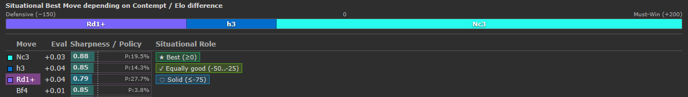
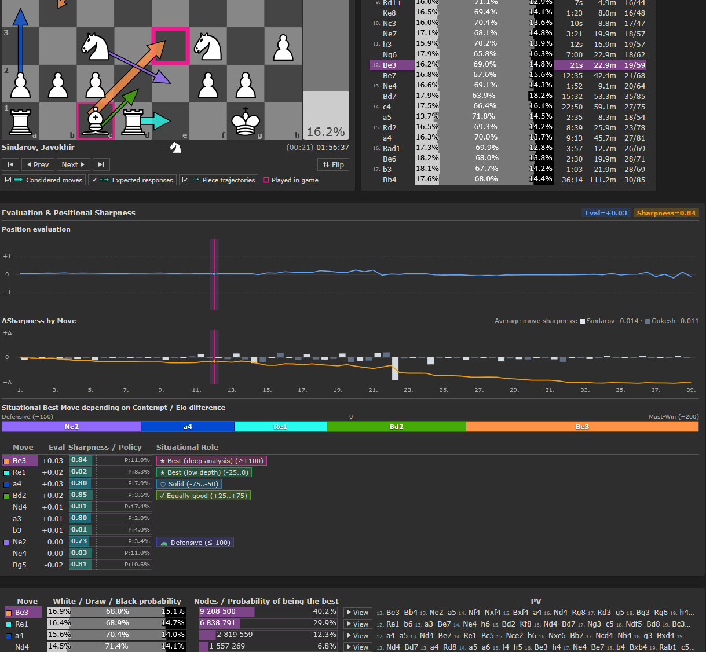
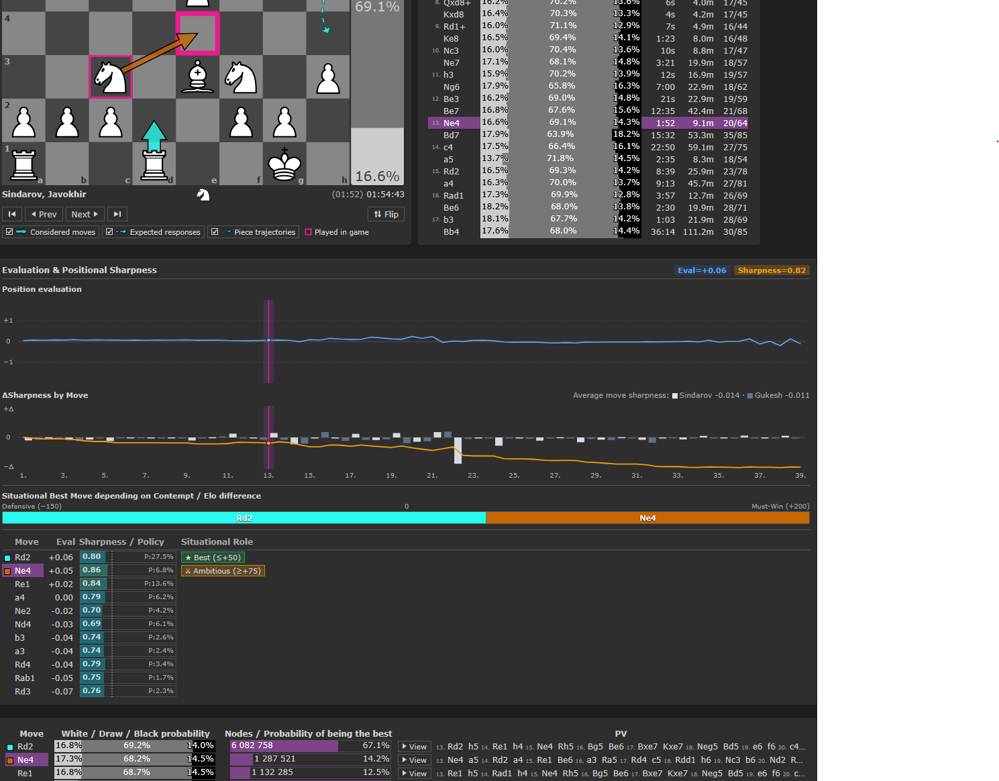
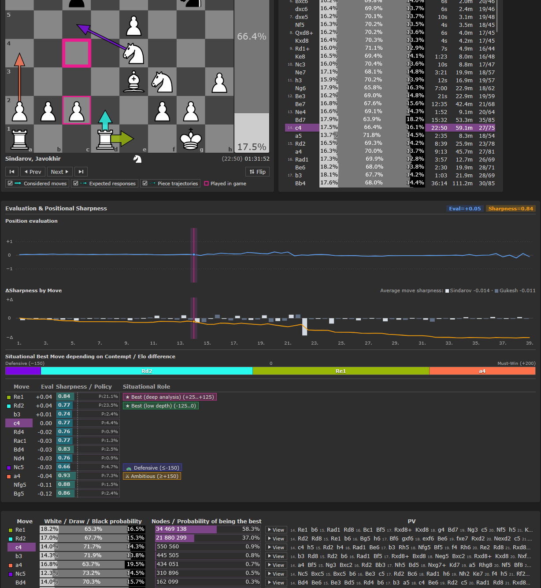
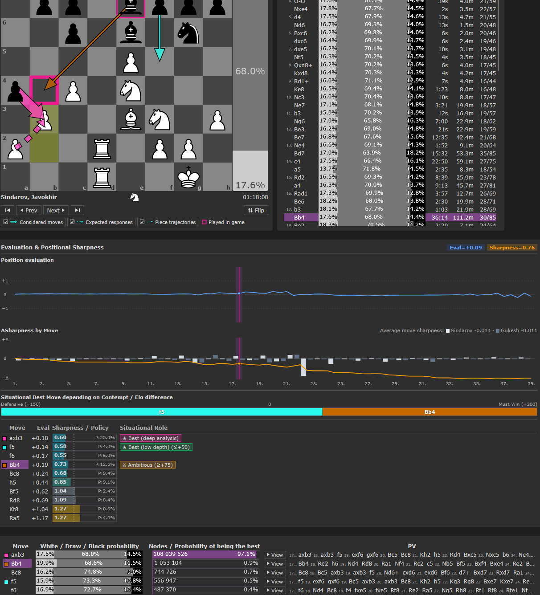
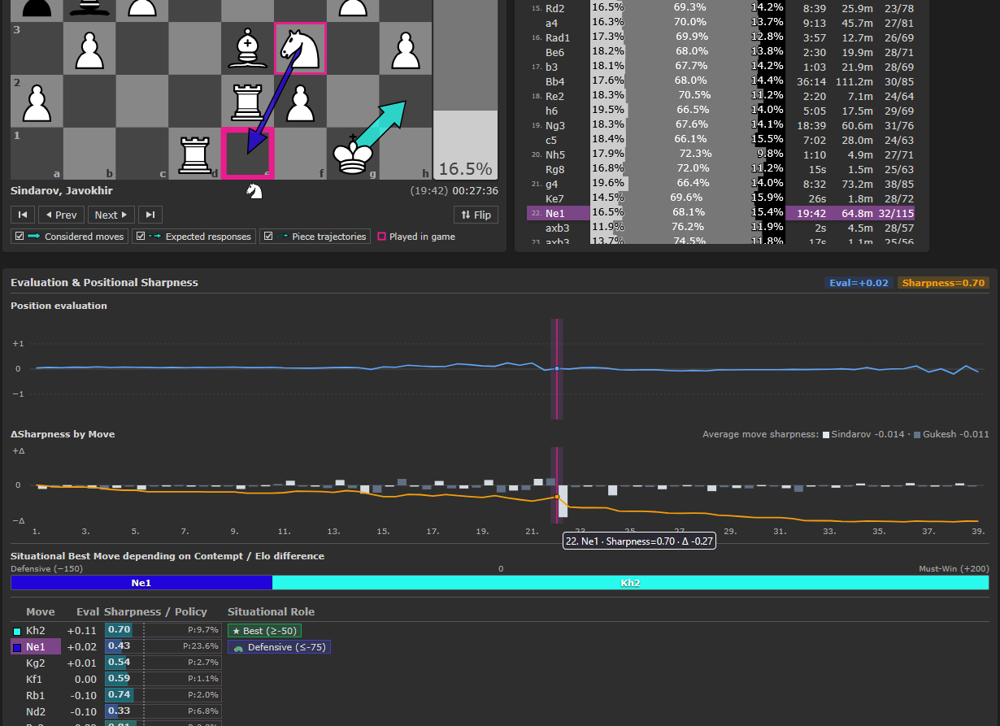

We're excited about presenting our updated https://live.lczero.org/ for the
World Chess Championship 2026 between Gukesh Dommaraju and Javokhir Sindarov.
Here we want to highlight selected real-time annotations of the matches powered by the LCZero engine from Game 1.

<!--more-->

If you're interested in more details about the LCZero live analysis website, we recommend taking a look at [this blog post](/blog/2026/11/lczero-live-analysis-for-wcc-2026/).

### Introduction and general remarks

First: We're engine developers and chess enthusiasts, but only (at most, if at all) hobby chess players. 
The https://live.lczero.org/ shows things we find interesting and insightful, and we're excited to share it because no other engine can provide this sort of insights.
The below analysis only strives to be a selection of interesting positions based on the LCZero specific insights. 
If you're doing commentary (be it via live stream, video recaps or in-depth post-game analysis), please feel free to use the analysis results and graphics from the website under the condition of giving credit to the website and LCZero project.

### Examples from Game 1 (Berlin endgame, early queen trade)

If you only look at the evaluation graph, you could determine that nothing happened at all in the game. However, having access to LCZero's native WDL predictions and variable Contempt analysis allows a much more nuanced and detailed view.

###### 9. Rd1+

The first move which isn't considered the best move, and also only the 3rd most common move. Instead of the sharper options 9. Nc3 (0.88) and 9. h3 (0.85), the more solid option 9. Rd1+ (0.79) is chosen.

###### 12. Be3

After committing the king side with 11. h3 (increasing the sharpness from 0.81 to 0.85) instead of the deep engine analysis favourite 11. a4 (0.78),
Sindarov chooses 12. Be3 which is the most active move from the top choices, and also the best move according to the deep engine analysis.

###### 13. Ne4

The first novel move of the opening, where Sindarov after almost 2 minutes plays 13. Ne4 instead of the engine top move 13. Rd2 which has been played before at the top level. Their evaluation is virtually equal, but both sharpness and Contempt favourite highlight that 13. Ne4 is the attacking move,
with 13. Rd2 (0.80) being the favourite up to +50 Contempt and 13. Ne4 (0.86) taking over afterwards.

###### 14. c4

Sindarov's first longer (and his longest) think of the game. In addition to the two rook moves Re1 and Rd2, the variable Contempt search highlights Nc5 and a4 as defensive resp. ambitious options. 
Sindarov ultimately plays 14. c4, giving up a bit of complication potential and the tiny advantage according to the engine.

###### 17. ... Bb4

A very crucial decision, and Gukesh's longest think. The deep LCZero analysis contradicts the low depth evaluation and picks axb3 as the best move. 
The variable Contempt analysis considers two moves as "situationally best": 17. ... f5 objectively, and 17. ... Bb4 as an ambitious option for Contempt >=75 which Gukesh chooses.

After a few moves including black's solid 19. ... c5 locking in the dark square bishops, sharpness has dropped below 0.60 from the initial 1.00 in the starting position, though 21. g4 Ke7 increases it a bit again.
On move 22, Sindarov decides the fate of the game with the defensive 22. Ne1, dropping the sharpness from 0.70 to 0.43, the biggest single swing in the game. After exchanging a few pawns, the game is quickly liquidated into a threefold repetition draw.

###### 22. Ne1

