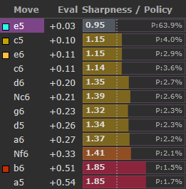
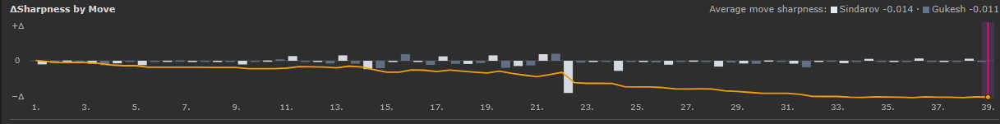
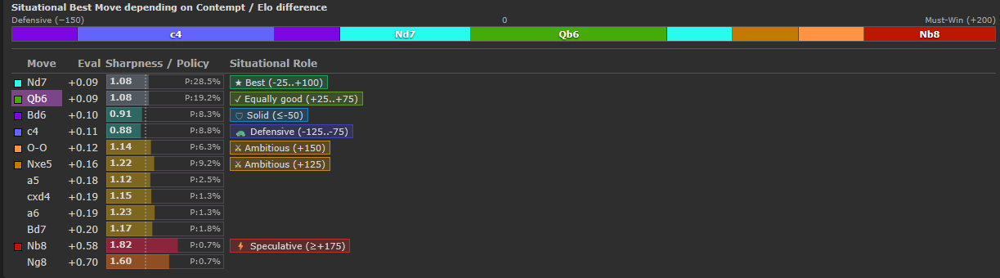

We're excited about presenting our updated https://live.lczero.org/ for the
World Chess Championship 2026 between Gukesh Dommaraju and Javokhir Sindarov.
On this site, you’ll be able to follow real-time annotations of the matches powered by the LCZero engine.

<!--more-->

You might be familiar with https://analysis.sesse.net/ which provides real-time analysis of the games using Stockfish for almost two decades now.
We'd like to showcase the distinctive features of LCZero that allow us to provide more insights into the games, for example:

* Showing probabilities of every game outcome (white wins, black wins, draw), rather than just a single centipawn evaluation, calibrated to time control and the players' Elo.
* Showing the evaluation and probability of each move being played by the players, rather than just the best move.
* Identify aggressive and defensive moves using different Contempt values for analysis.

The first game was already played on November 24th, you'll find analysis examples of some key positions in a separate [WCC Game 1 analysis with LCZero live](/blog/2026/11/wcc-2026-game-1-lczero-live-analysis/) blog post.

---

### Making sense of all the arrows

The arrows haven't been changed from when we introduced the LCZero live analysis for the WCC 2024 in our [blog post](/blog/2024/11/wcc24-live/), so you might find the following description familiar:

* Variations starting with different moves are displayed in distinct colors, with thicker lines representing more likely variations.
  * For each variation, you'll see the probability of each outcome (white win, black win, draw) and the likelihood of that move being the best choice.  

* Within each variation:
    * Solid lines represent moves by the player whose turn it is.
    * Dashed lines indicate the opponent's moves.
    * When the same piece moves consecutively within a variation (i.e. makes a maneuver), these moves are shown with thin lines.  

* When reviewing previous moves, the move that was actually played is highlighted with a pink outline and a lavender background. 

* You can click on a variation row or a specific move there to explore the line move by move.

What has changed however is the selection of the arrows. Instead of just showing the most explored choices, the board now shows all "situationally best" moves, with a temperature color scheme representing defensiveness / aggression.

### Technical details and hardware upgrade

The analysis is done on the following hardware:

* 4 x RTX 5080 GPUs for the main analysis, 4 x RTX 5080 for the Sharpness annotation and backfilling missing moves
* AMD EPYC 7502 32-Core Processor
* 512 GB RAM
* Network running is the new BT6-6000000

The probabilities will be [adjusted](/blog/2023/07/the-lc0-v0.30.0-wdl-rescale/contempt-implementation/) by the players' ratings.

We’re hopeful it’ll manage the traffic smoothly, although we're uncertain about how much popularity to expect.

### New: Sharpness and Situational Role

Traditionally, the way we're talking about positions with engine evaluations in mind is the advantage for white or black in centipawn units. 
Strong players and commentators might on top assess the practical complications in a position or a specific opening line with terms like "sharp", "chaotic", "complex", "tension" with an intuitive meaning but no clear definition.
However, there isn't a clear definition of this intuitive term, and it is used at the same time for positional complexity and imminent complicated tactics.
Furthermore, interpreting engine output in terms of complexity is difficult and inconsistent, at least beyond observing fluctuating eval and the draw rate for engines providing native WDL predictions.

For LCZero, two aspects of complexity are being used:

* _Positional complexity_ using the WDL head for the [WDL Contempt implementation](/blog/2023/07/the-lc0-v0.30.0-wdl-rescale/contempt-implementation/) and the internalized Contempt in the specialized [Piece Odds networks](/blog/2024/11/fine-tuning-lc0-network-for-odds-games/)
* _Tactical complexity_ using the Policy head for [Search Contempt](https://arxiv.org/html/2504.07757v1) used in the Piece Odds bots on lichess

Calculating positional complexity can be provide additional insights into a position by analyzing it with a range of Contempt value and observe how much it affects the evaluation and move ordering.

In addition to the deep analysis and WDL outputs, https://live.lczero.org/ now also runs an extra analysis (lower depth than the deep analysis) on potentially interesting moves with variable [Contempt](/blog/2023/07/the-lc0-v0.30.0-wdl-rescale/contempt-implementation/) from -150 to +200. From this analysis, the following annotations are derived:

* Positional sharpness for each position and candidate move
* Attribution of which player complicates or simplifies the game
* Identifying "situationally best" moves for attacking and defending based on the Contempt values where they're the first choice

#### Sharpness

The "sharpness" (or "tension") represents how much varying Contempt in the LCZero analysis affects the predicted score. 
Calibrated to 1.00 at the starting position, it allows an immediate comparison of openings and candidate moves regarding the tension as perceived by LCZero.

However, it's worth noting that a move or position having a high "sharpness" only means that there is a lot of play left in the position; it doesn't imply tactical complexity or imminent blunder potential, but positional tension.

#### Situational Role

All "situationally best" moves are displayed on the board, with a temperature color scheme from cold (defensive) to hot (speculative), and a label explaining their "Situational Role" and optimal Contempt range in brackets. 

The possible "Situational Role" labels are

* _Best:_ The best move at 0 Contempt
* _Best (low depth)_ and _Best (deep analysis)_: Rarely, the main analysis will disagree with the low depth (10k nodes for each move) analysis.
* _Equally good:_ Basically identical to the best move in eval and sharpness.
* _Ambitious:_ Best move at some positive Contempt value, and significantly higher sharpness than the objectively best move.
* _Solid:_ Best move at some negative Contempt value, and significantly lower sharpness than the objectively best move.
* _Speculative:_ Best move only at very high positive Contempt, and objectively worse than the best move.
* _Defensive:_ Best move at very high negative Contempt, and substantially lower sharpness than the best move.

### Future Outlook

This is the first time we've presented this special analysis feature to a broader audience, so we're happy to hear your thoughts and suggestions in our [Discord](https://lc0.org/chat).
